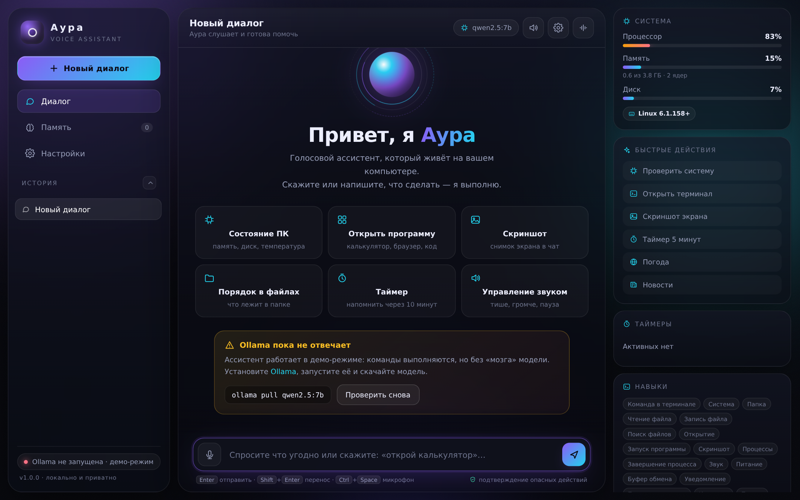
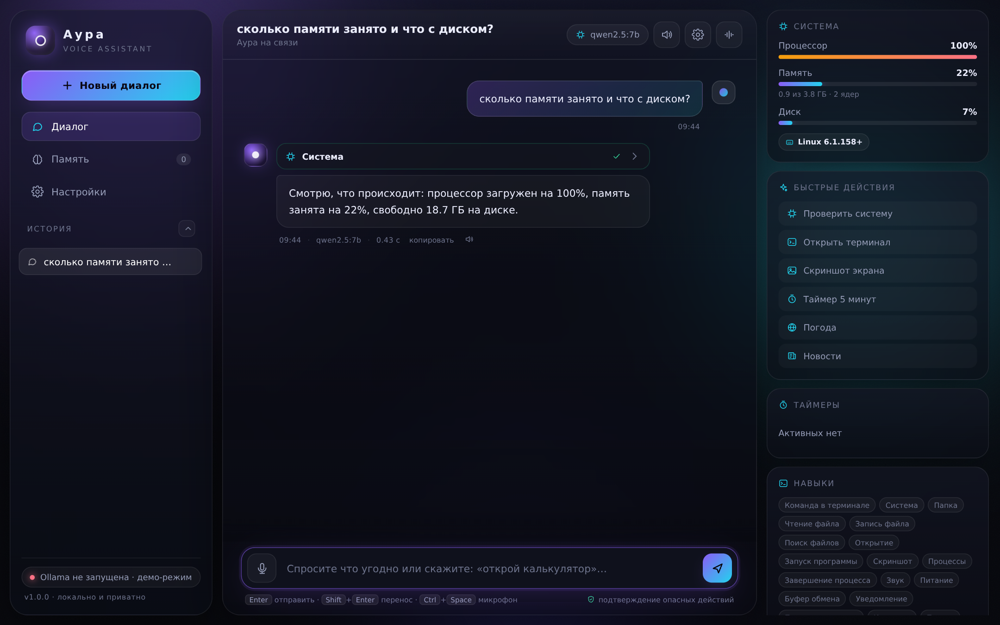
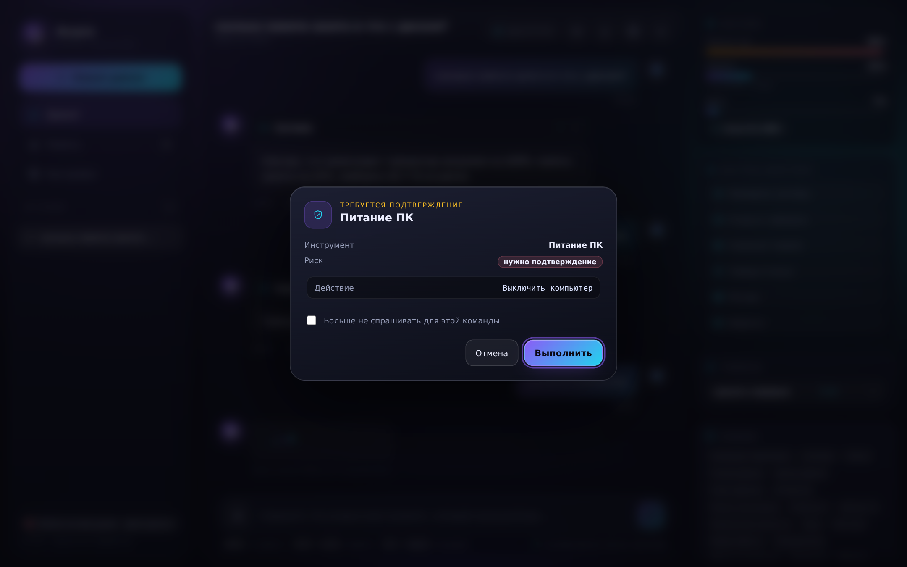
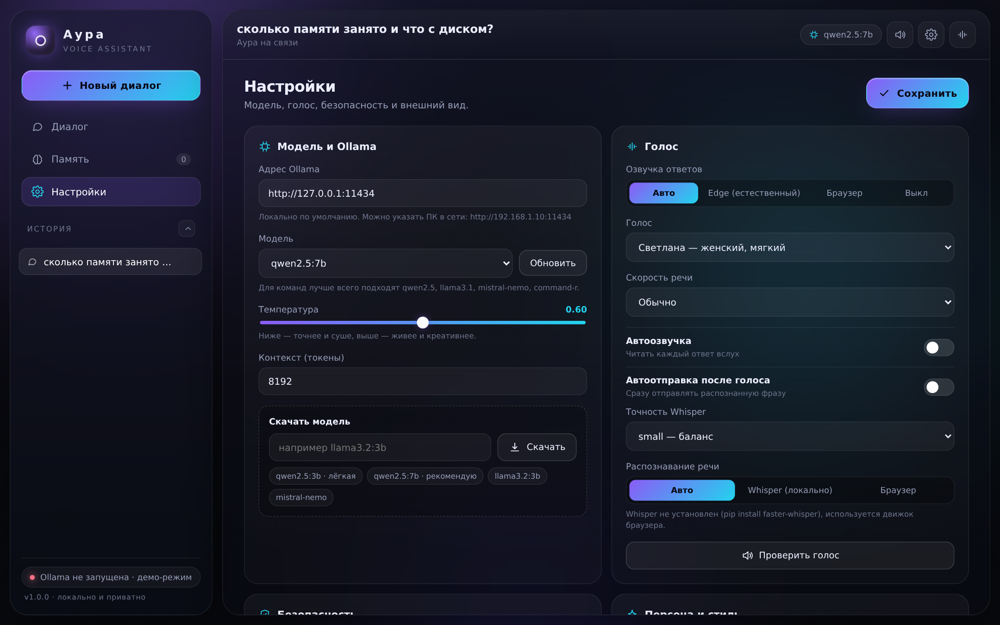
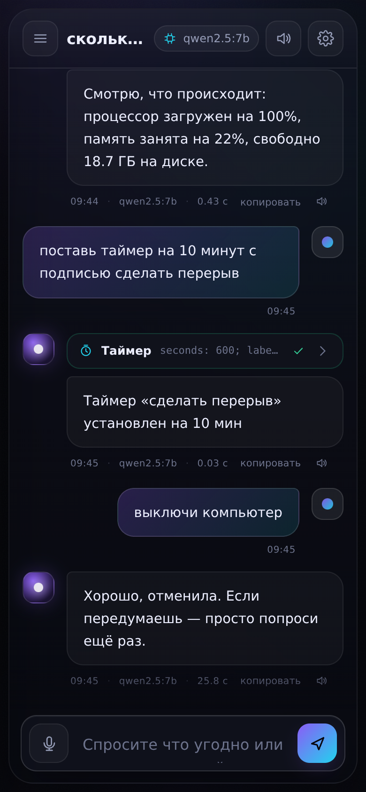
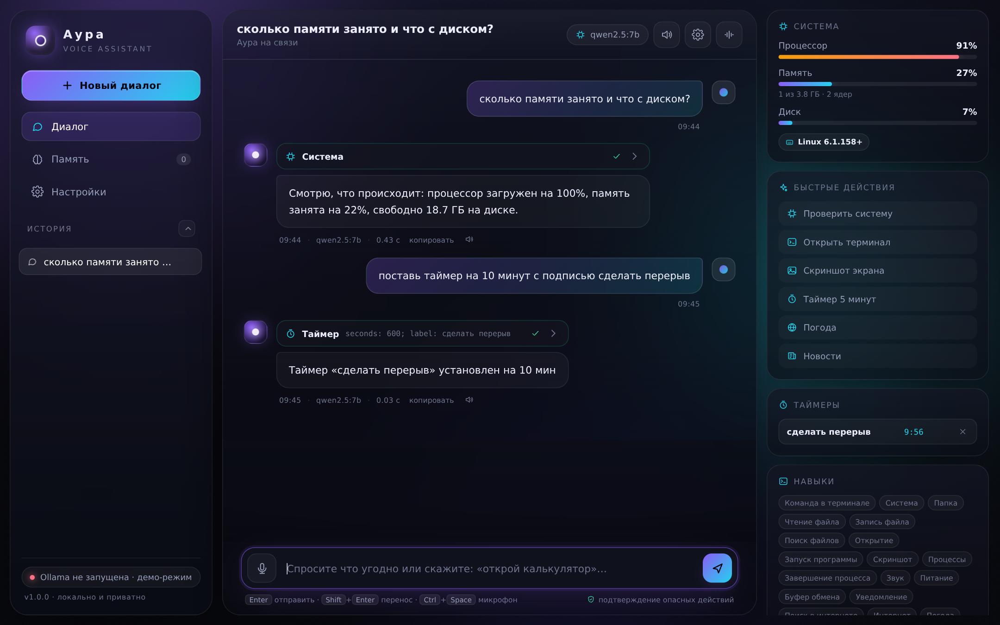
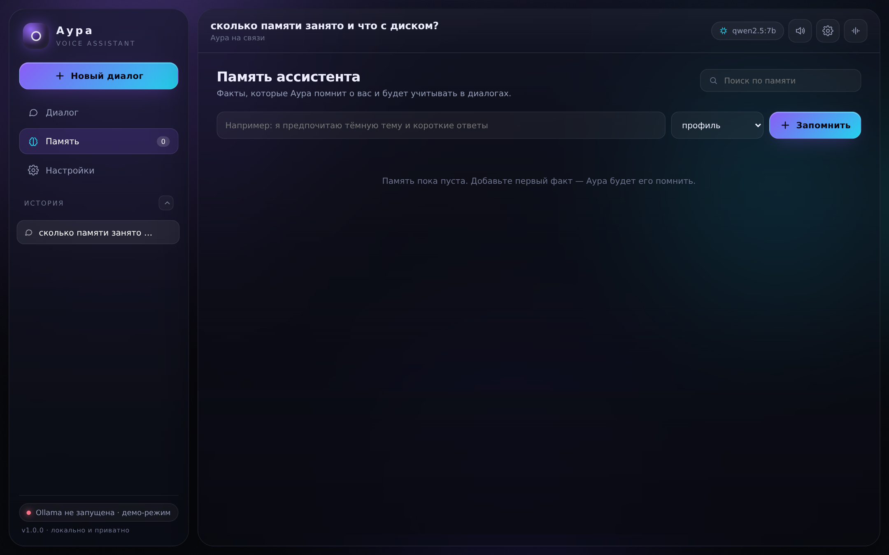

# ✦ Аура — голосовой ИИ-ассистент на вашем ПК

Локальный голосовой ассистент, который работает через **[Ollama](https://ollama.com)** и реально управляет компьютером:
открывает программы, ищет файлы, делает скриншоты, меняет громкость, выполняет команды в терминале,
ставит таймеры, узнаёт погоду и новости — и всё это голосом, в красивом тёмном интерфейсе.

```
Вы:      «Аура, открой калькулятор»
Аура:    ▸ Запускаю калькулятор
Вы:      «Сколько памяти занято?»
Аура:    ▸ Память 41% — 6.4 из 16 ГБ, процессор 12%. Всё спокойно.
```

---

## Готовый .exe (Windows)

Собранный `Аура.exe` лежит в разделе **Releases** этого репозитория:

1. Скачайте `Aura-Assistant-Windows-x64.zip` и распакуйте в любую папку.
2. Установите [Ollama для Windows](https://ollama.com/download/windows) и один раз выполните:
   ```powershell
   ollama pull qwen2.5:7b
   ```
3. Запустите **`Аура.exe`** — откроется браузер с интерфейсом, а в системном трее появится иконка
   Ауры (меню: открыть, папка данных, выход).

Python, pip и установка зависимостей не нужны — всё внутри. Данные (настройки, история, память)
хранятся в папке `data` рядом с `.exe`, лог — `data/aura.log`.

> Нужен Windows 10/11 x64. Сборка без цифровой подписи, поэтому SmartScreen может спросить
> подтверждение при первом запуске: «Подробнее» → «Выполнить в любом случае».

Собрать `.exe` самому — см. раздел [«Сборка .exe»](#сборка-exe).

---

## Возможности

| | |
|---|---|
| 🎙 **Голосовое управление** | Распознавание речи локально через faster-whisper или движком браузера |
| 🔊 **Естественная озвучка** | Edge-TTS (голоса Светлана, Дарья, Дмитрий) или голос браузера |
| 🖥 **Управление ПК** | 26 инструментов: программы, файлы, терминал, процессы, звук, питание, буфер обмена |
| 🛡 **Безопасность** | Подтверждение опасных действий, чёрный список разрушительных команд, защита системных папок |
| 🧠 **Память** | Запоминает факты о вас («я люблю короткие ответы») и учитывает их в диалогах |
| 💬 **История** | Все диалоги сохраняются локально в `data/sessions.json` |
| ⏰ **Таймеры** | «Напомни через 20 минут про чай» — скажет вслух и покажет уведомление |
| 🎨 **Красивый интерфейс** | Тёмная стеклянная тема, анимированный орб, 5 цветовых акцентов, адаптив под телефон |
| 🔒 **Приватность** | Никаких облаков и аккаунтов: модель и данные — только на вашем компьютере |



<details>
<summary>Ещё скриншоты: диалог, подтверждение действия, настройки, мобильная версия</summary>

| Диалог с инструментами | Подтверждение опасного действия |
|---|---|
|  |  |

| Настройки | Мобильная версия |
|---|---|
|  |  |

| Таймер и память | Навыки в панели |
|---|---|
|  |  |

</details>

---

## Что понадобится

1. **Python 3.9+** — [python.org/downloads](https://www.python.org/downloads/) (на Windows отметьте *Add python.exe to PATH*)
2. **Ollama** — [ollama.com/download](https://ollama.com/download)
3. Одна модель (4–5 ГБ), например `qwen2.5:7b` — лучшее соотношение «ум/скорость» для команд
4. Интернет — только для установки и озвучки Edge-TTS. Сам ассистент работает офлайн.

> Для слабых ПК (8 ГБ ОЗУ или без видеокарты) возьмите `qwen2.5:3b` или `llama3.2:3b`.

---

## Установка на Windows

### Вариант 1 — одной командой (рекомендуется)

1. Скачайте папку проекта (или `git clone`).
2. Нажмите правой кнопкой по `install.ps1` → **Выполнить с помощью PowerShell**.
   Если Windows блокирует — откройте PowerShell в папке проекта и выполните:
   ```powershell
   powershell -ExecutionPolicy Bypass -File .\install.ps1
   ```
3. Установщик создаст окружение, поставит зависимости, предложит скачать модель
   и добавит ярлык **«Аура»** на рабочий стол.

### Вариант 2 — вручную

```bat
py -3 -m venv .venv
.venv\Scripts\python.exe -m pip install -r requirements.txt
ollama pull qwen2.5:7b
start.bat
```

### Запуск

Двойной клик по `start.bat` (или ярлыку «Аура»). Откроется браузер с интерфейсом:
**http://localhost:8765**. Терминал можно свернуть — он держит сервер.

---

## Установка на Linux / macOS

```bash
python3 -m venv .venv
.venv/bin/pip install -r requirements.txt
ollama pull qwen2.5:7b
./start.sh
```

Для системных действий на Linux полезны: `xclip` (буфер обмена), `playerctl`/`pactl` (звук),
`gnome-screenshot`/`scrot`/`grim` (скриншоты), `libnotify-bin` (уведомления).

---

## Голос

**Микрофон.** Нажмите кнопку микрофона или `Ctrl+Space`, говорите, затем ✓ — текст распознается
и попадёт в поле ввода (или отправится сразу, если включена автоотправка).

- **faster-whisper** (локально, точно, но нужен пакет `faster-whisper` и ~1 ГБ на модель `small`):
  ```bash
  .venv/bin/pip install faster-whisper
  ```
  При первом распознавании модель скачается автоматически.
- **Движок браузера** — работает сразу, без установки, но требует интернет в Chrome и качества микрофона.

**Озвучка.** Ответы можно читать вслух автоматически (переключатель в настройках) или кнопкой 🔊 под сообщением.

- **Edge-TTS** — самый естественный голос, нужен интернет и пакет `edge-tts` (ставится по умолчанию).
- **Браузер** — офлайн-голос системы, без интернета.
- Голос, скорость и автоозвучка настраиваются в разделе **Настройки → Голос**.

**Горячие клавиши:** `Ctrl+Space` — микрофон, `Enter` — отправить, `Shift+Enter` — перенос строки,
`Ctrl+K` — фокус на поле ввода, `Esc` — остановить/закрыть.

---

## Безопасность

Ассистент может выполнять команды на вашем компьютере, поэтому в нём есть защита в три уровня:

1. **Всегда запрещено** (даже с подтверждением): `rm -rf /`, форматирование дисков, `mkfs`, `diskpart`,
   `bcdedit`, очистка `cipher /w`, запись в `C:\Windows` и `/etc`/`/usr`/`/boot`, `rm -rf /*` и подобное.
2. **Требует подтверждения**: удаление и перемещение файлов, `taskkill`, установка пакетов, `shutdown`,
   блокировка экрана, запись файлов, любые изменяющие команды. В окне подтверждения видно точную команду,
   а галочка «больше не спрашивать» добавляет её в белый список (`data/config.json`).
3. **Выполняется сразу**: чтение файлов и папок, информация о системе, погода, новости, поиск, время, память.

Режимы в **Настройках → Безопасность**:

| Режим | Что делает |
|---|---|
| С подтверждением (по умолчанию) | спрашивает только про опасные действия |
| Автоматический | выполняет всё сразу — быстрее, но без страховки |
| Строгий | подтверждает вообще любое действие |

Запись файлов разрешена только в домашней папке и временной директории.
Домашняя папка и рабочий каталог задаются в настройках.

---

## Модели

| Модель | Размер | Кому |
|---|---|---|
| `qwen2.5:3b` | ~2 ГБ | слабый ПК / ноутбук |
| `qwen2.5:7b` | ~4.7 ГБ | **рекомендуется**: хорошо понимает команды |
| `qwen2.5:14b` | ~9 ГБ | 16+ ГБ ОЗУ, максимальное качество |
| `llama3.2:3b` | ~2 ГБ | быстрая и лёгкая альтернатива |
| `mistral-nemo` | ~7 ГБ | отличное следование инструкциям, 12B |
| `command-r` | ~20 ГБ | сложные многошаговые задачи |

Скачать модель можно прямо из интерфейса: **Настройки → Модель → Скачать модель** (с прогресс-баром),
или в терминале:

```bash
ollama pull qwen2.5:7b
```

Модели без поддержки инструментов (Gemma, Phi-3, LLaVA и др.) тоже работают — ассистент
автоматически переключается на текстовый протокол вызова инструментов.

---

## Навыки ассистента

| Группа | Что умеет |
|---|---|
| **Терминал** | `run_command` — любые команды PowerShell / cmd / bash, с таймаутом и обрезкой вывода |
| **Система** | `system_info` (CPU, ОЗУ, диски, батарея, процессы), `screenshot` |
| **Файлы** | `list_dir`, `read_file`, `write_file`, `search_files` |
| **Программы** | `open_app` (калькулятор, браузер, Telegram, VS Code…), `open_path`, `list_processes`, `close_process` |
| **Звук и питание** | `media_control` (громкость, mute, play/pause, треки), `power_action` (сон, блокировка, выключение, перезагрузка) |
| **Системные мелочи** | `clipboard`, `notify` |
| **Интернет** | `web_search`, `http_get`, `weather`, `news` |
| **Память и время** | `remember`, `recall`, `forget`, `set_timer`, `list_timers`, `cancel_timer`, `current_time` |

Примеры фраз:

```
«Открой проводник и покажи папку Загрузки»
«Найди на диске все файлы .pdf, изменённые сегодня»
«Какая погода в Нижневартовске на завтра?»
«Сделай скриншот и посмотри, какая ошибка на экране»
«Закрой Chrome»
«Поставь на паузу музыку и убавь звук»
«Запомни: я работаю над проектом Аура и люблю короткие ответы»
«Напомни через 25 минут сделать перерыв»
«Сколько осталось места на диске C?»
```

---

## Настройки

Все параметры хранятся в `data/config.json` (создаётся автоматически) и меняются в интерфейсе:

```json
{
  "ollama_url": "http://127.0.0.1:11434",
  "model": "qwen2.5:7b",
  "temperature": 0.6,
  "num_ctx": 8192,
  "assistant_name": "Аура",
  "user_name": "",
  "tts": { "engine": "auto", "voice": "ru-RU-SvetlanaNeural", "rate": "+0%" },
  "stt": { "engine": "auto", "model_size": "small", "language": "ru" },
  "safety": { "mode": "confirm", "workspace": "C:\\Users\\Имя" }
}
```

Полезно знать:

- **Ollama на другом ПК**: укажите `http://192.168.1.10:11434` и запустите Ollama на том компьютере
  с `OLLAMA_HOST=0.0.0.0` (тогда ассистент будет управлять этим ПК, а думать — на мощном).
- **Доступ с телефона по Wi-Fi**: запустите `python run.py --host 0.0.0.0`, откройте
  `http://IP-компьютера:8765` на телефоне. Голосовой ввод работает и там.
- **Автозапуск**: положите ярлык на `start.bat` в папку
  `%APPDATA%\Microsoft\Windows\Start Menu\Programs\Startup`.

Параметры запуска:

```bash
python run.py --host 0.0.0.0 --port 8765 --no-browser --reload
```

---

## Структура проекта

```
ffr/
├── run.py                 # точка входа (порт, браузер, баннер)
├── start.bat / start.sh   # запуск в один клик
├── install.ps1            # установщик для Windows
├── requirements.txt
├── app/
│   ├── main.py            # FastAPI: REST + SSE
│   ├── chat.py            # цикл агента: LLM ⇄ инструменты, подтверждения
│   ├── ollama.py          # клиент Ollama (стрим, tool calling, pull)
│   ├── voice.py           # Edge-TTS и faster-whisper
│   ├── safety.py          # классификация риска команд, защита путей
│   ├── sessions.py        # история диалогов
│   ├── memory.py          # долговременная память
│   ├── timers.py          # таймеры и напоминания
│   └── tools/             # 26 инструментов управления ПК
│       ├── shell.py  files.py  system.py  os_actions.py
│       ├── processes.py  web.py  memory_tools.py
│       └── registry.py
├── web/                   # интерфейс без сборки: HTML + CSS + JS
│   ├── index.html  styles.css  app.js
│   └── manifest.webmanifest  sw.js  icon.svg
├── data/                  # настройки, история, память, скриншоты, аудио
└── tests/ui-smoke.mjs     # смоук-тест интерфейса (jsdom)
```

---

## API

Пригодится для интеграций и автоматизации (всё локально):

| Метод | Путь | Назначение |
|---|---|---|
| `GET` | `/api/state` | настройки, модели, голос, таймеры, навыки |
| `POST` | `/api/chat` | диалог; ответ — SSE-поток событий `token`, `tool_start`, `tool_result`, `confirm` |
| `POST` | `/api/confirm` | разрешить/запретить действие `{session_id, approved, remember}` |
| `POST` | `/api/stop` | остановить выполнение |
| `POST` | `/api/tts` | текст → mp3 |
| `POST` | `/api/stt` | аудиофайл → текст |
| `GET` | `/api/memory`, `POST`, `DELETE /{id}` | память |
| `GET` | `/api/timers`, `DELETE /{id}` | таймеры |
| `GET` | `/api/models`, `GET /api/models/pull?model=…` | модели и скачивание |
| `GET` | `/api/system` | живая телеметрия ПК |

---

## Частые проблемы

**«Ollama не запущена»**
Запустите Ollama из меню Пуск или выполните `ollama serve` в терминале. Проверьте:
`curl http://127.0.0.1:11434/api/version`. Приложение продолжает работать в демо-режиме.

**«Модель не загружена»**
`ollama pull qwen2.5:7b` или Настройки → Скачать модель.

**Модель отвечает «не могу выполнить команду»**
Возьмите модель с поддержкой инструментов (qwen2.5, llama3.1, mistral-nemo, command-r).
Мелкие модели (1–3B) хуже следуют инструкциям — для команд лучше 7B.

**Не работает микрофон**
Браузер спрашивает разрешение при первом нажатии; разрешите доступ к микрофону в настройках сайта.
`localhost` считается безопасным источником — HTTPS не нужен.

**Нет звука/скриншота на Linux**
Установите `pactl` (pulseaudio-utils) и `gnome-screenshot`/`scrot`/`grim`.

**Порт занят**
`run.py` сам подберёт следующий свободный порт и покажет адрес в консоли.

**Браузер не открылся**
Перейдите по адресу из консоли (обычно `http://localhost:8765`).

---

## Сборка .exe

### Локально на Windows

```powershell
powershell -ExecutionPolicy Bypass -File .\build-exe.ps1
```

Скрипт создаст окружение, поставит зависимости и PyInstaller, соберёт проект и упакует архив:

| Файл | Что это |
|---|---|
| `dist\Аура\Аура.exe` | обычная сборка (папка, быстрый старт) |
| `Aura-Assistant-Windows-x64.zip` | готовый архив для передачи другим |
| `dist\Аура.exe` | одиночный файл, если запустить `build-exe.ps1 -OneFile` |

Полезные флаги: `-OneFile` (всё в один файл), `-SkipTests` (без проверки синтаксиса).

### Автоматически через GitHub Actions

`.github/workflows/build-windows-exe.yml` собирает `.exe` на `windows-latest`
и прикладывает архив к артефактам. Запуск:

```bash
gh workflow run build-windows-exe.yml --ref main
gh run watch
```

Создать релиз с готовым архивом — запустить workflow с параметром `release_tag`
(например `v1.0.0`) или просто поставить тег:

```bash
git tag v1.0.0 && git push origin v1.0.0
```

Там же есть джоба **verify-packaging**: она собирает бинарь на Linux, запускает его и
проверяет, что интерфейс и API отдаются из собранного бандла — так ловятся ошибки
упаковки до Windows-сборки.

### Что внутри .exe

- PyInstaller (`aura.spec`): код ассистента + `web/` + Edge-TTS + сертификаты.
- Иконка `web/icon.ico`, иконка в трее (`pystray` + `Pillow`).
- Консоли нет: запуск двойным кликом, интерфейс в браузере, управление из трея.
- `faster-whisper` в сборку не входит (тяжёлый) — распознавание работает через браузер.
  Нужен локальный Whisper — поставьте пакет и запускайте из исходников.

---

## Тесты

```bash
python -m compileall app run.py                # синтаксис бэкенда
.venv/bin/python tests/integration.py          # 27 проверок: демо-режим, tool calling, подтверждения, таймеры, безопасность
npm install jsdom && node tests/ui-smoke.mjs   # 32 проверки интерфейса (jsdom)
```

Интеграционный тест поднимает заглушку Ollama (`tests/fake_ollama.py`) и сам ассистент
в изолированной папке данных — реальная модель не нужна.

Скриншоты для документации:

```bash
npm i -D puppeteer-core @sparticuz/chromium && node tests/screenshots.mjs
```

---

## Лицензия и благодарности

Проект использует: [Ollama](https://ollama.com), [FastAPI](https://fastapi.tiangolo.com),
[edge-tts](https://github.com/rany2/edge-tts), [faster-whisper](https://github.com/SYSTRAN/faster-whisper),
[psutil](https://github.com/giampaolo/psutil).

Код можно свободно использовать и менять для личных задач.
